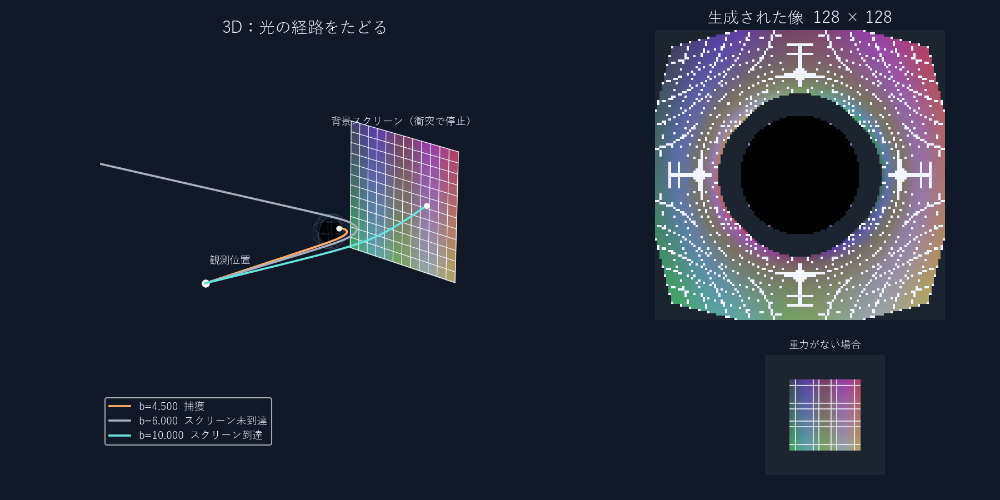

# ブラックホールのそばで、光はどう曲がる？

文化祭のポスターから来てくださった皆さんへ。  
ブラックホールの向こうに模様のついた板があったら、私たちにはどう見えるでしょうか？

この研究では、ブラックホールの近くを通る**光の道筋をコンピューターで計算**し、背景の模様がゆがんで見える様子を調べています。光が吸い込まれる場合、曲がって背景に届く場合、背景を外れる場合を、3Dの経路と観測画像で見比べられます。

## ここが見どころ

- **光の進み方を比べる**：「ねらいのずれ」を変えると、光の行き先はどう変わる？
- **画像の1点から道筋をたどる**：生成した像をクリックすると、その画素に対応する光線を3Dで表示。
- **重力の有無を比べる**：同じ背景がどのように変形するかを並べて確認。



> ※実際の天体写真ではなく、一般相対性理論に基づきPythonで計算・描画したシミュレーション画像です。

---

## まずはこの順で操作

1. **「3本を比較」**を押すと、ねらいのずれ `b/M = 4.5, 6, 10` の経路を表示します。左の3D図はドラッグで回転できます。
2. **「光線のねらいのずれ b/M」**と**「軌道の向き ψ」**を変え、**「光線を発射」**を押して比べます。「停止 / 再開」でアニメーションを切り替え、「視点を戻す」で視点を戻せます。
3. 背景を「色つき格子」または「星空」から選び、最初は解像度128で**カーソルを合わせて「像を生成」**を押します。
4. 生成された右上の像をクリックすると、その画素の光線を左に表示します。**「JPGで保存」**で生成像を保存できます。

| 生成画像の色 | 意味 |
| --- | --- |
| 背景の模様 | 追跡した光線が背景スクリーンに到達 |
| 黒 | ブラックホールに捕獲 |
| 濃灰 | 計算の外側境界まで追跡したが、スクリーン未到達 |
| マゼンタ | 計算回数の上限に達し、未判定 |
| 赤 | 数値エラー |

---

## どんな原理で計算するの？

重力があると、時空の形が変わり、光の道筋も曲がります。このモデルでは、回転せず電荷を持たないブラックホールを表す**Schwarzschild（シュワルツシルト）時空**を使います。その中で光が進む道筋を「光の測地線」と呼びます。

- **事象の地平面（半径2M）**：ここまで到達した光線を「捕獲」とします。
- **光子球（半径3M）**：光が円軌道を取り得る場所ですが、その軌道は不安定です。
- **臨界衝突パラメータ（$b \simeq 5.196M$）**：遠方から入射する光の捕獲と散乱を分ける理論上の境目です。
- **RK4（4次のルンゲ＝クッタ法）**：光の運動を表す微分方程式を小さな区間に分けて数値的に解いています。

像を作るときは、観測者から各画素の方向へ光線を**逆向きにたどり**、背景のどこに行き着くかを調べてその場所の色を読み取っています。

---

<details>
<summary><b>💻 パソコンでご自身の環境から動かしてみたい方へ（クリックして展開）</b></summary>

このプログラムはPython（Tkinter等を使用）で動くデスクトップアプリです。スマートフォンやブラウザー上からは直接起動できません。

### 1. 動作環境
- Python 3 （検証環境：Python 3.13.12 / Windows 11）
- 必要なライブラリ：`NumPy`, `Matplotlib`, `Pillow`

### 2. 起動手順
1. このページ上部の **Code → Download ZIP** でダウンロードし、ZIPを展開します。
2. 展開したフォルダーをターミナル（PowerShell等）で開きます。
3. 次のコマンドを順に実行します。

```sh
python -m pip install -r requirements.txt
python ray_tracing_3d.py
